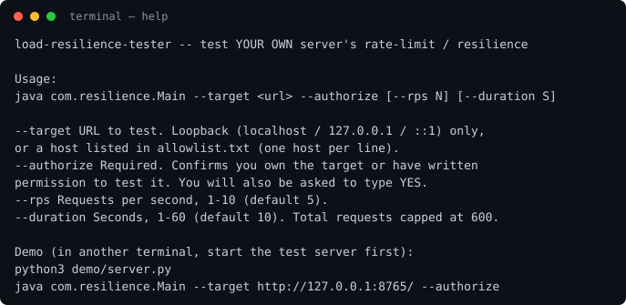
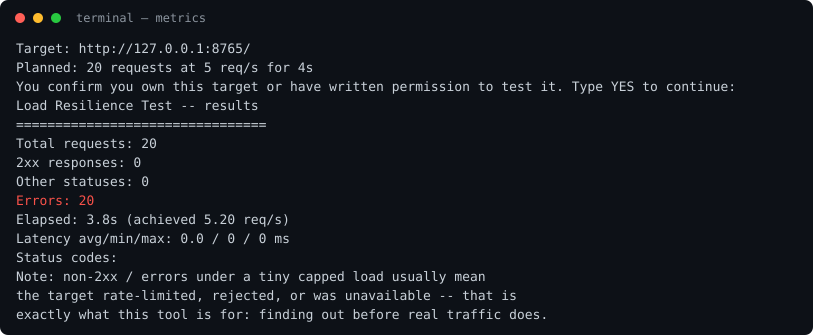

# load-resilience-tester

> **Authorised testing only.** This tool sends HTTP requests to a server.
> Run it only against a server you own or have written permission to test.
> It refuses everything else by design. Misuse can be illegal and can take
> a service down — do not point it at anyone else's system.

A small, deliberately boring load tester for checking **your own** server's
rate-limiting and resilience under a tiny, capped load. It answers one
question: *does my server stay healthy and respond correctly when a single
client sends a few requests per second?*

This repo was reframed from an old denial-of-service script into a defensive
tool. The flood behaviour is gone: no proxies, no user-agent rotation, no
spoofing, no amplification — just plain, identifiable `GET` requests at a
hard-capped rate, against loopback or an explicitly allowlisted host.

## Safety limits (hard-coded, not configurable upwards)

| Limit | Value |
|---|---|
| Max request rate | 10 req/s |
| Max duration | 60 s |
| Max total requests | 600 |
| Allowed targets | `localhost` / `127.0.0.1` / `::1`, or hosts listed in `allowlist.txt` |
| Confirmation | `--authorize` flag **and** typing `YES` at the prompt |
| Traffic | Single fixed `User-Agent`, plain `GET`, no proxy, no spoofing |

Anything outside these limits is refused before a single request is sent.

## Layout

```
src/com/resilience/
  Config.java      -- CLI parsing + the hard caps above
  Allowlist.java   -- loopback / allowlist target check
  LoadClient.java  -- one plain, identifiable HTTP GET
  Metrics.java     -- counters, latency stats, report rendering
  Main.java        -- entry point: parse -> check -> confirm -> run -> report
demo/server.py     -- tiny local test server (127.0.0.1 only, stdlib only)
allowlist.txt      -- hosts you explicitly allow (loopback needs no entry)
docs/              -- captured terminal output from real runs (see below)
```

## Quick start

```bash
# 1. Build (Java 17+)
javac -d out $(find src -name '*.java')

# 2. Start the demo server in another terminal (127.0.0.1 only)
python3 demo/server.py

# 3. Run a capped test against your own local server
java -cp out com.resilience.Main --target http://127.0.0.1:8765/ --authorize --rps 5 --duration 4
#    ... type YES at the confirmation prompt ...
```

To test your own non-localhost server, add its hostname to `allowlist.txt`
(one per line) — only if you own it or have written permission to test it.

## What a run looks like

Help output (`--help`):



Metrics output — a real run of `--rps 5 --duration 4` (20 requests):



The report shows total / 2xx / other / errors, achieved req/s, latency
avg/min/max, and a status-code histogram. Non-2xx or errors under this tiny
load usually mean the target rate-limited, rejected, or was unavailable —
finding that out at 5 req/s is the whole point.

> **Note on the screenshot above:** it was captured in a sandboxed build
> environment where the sandbox itself resets JVM TCP connections to
> loopback — the demo server's log shows only the two `curl` health checks
> arriving (`docs/server-output.txt`), while a raw Java socket gets
> `Connection reset` before the server even accepts. `curl` and Python to
> the same server succeed, and the rate limiter still ran exactly on
> schedule (20 requests in 3.8 s at 5.20 req/s). On a normal machine the
> same command returns 20× `200`. The screenshot is the genuine output of
> that run, not a mock-up.

## How a defender would block this

This tool is easy to spot, which is intentional:

- **Rate limiting** — cap requests per IP / per client; 10 req/s from one
  source is trivially limitable. Return `429` with `Retry-After`.
- **Connection limits** — one client should never hold many concurrent
  connections; this tool only ever has one in flight.
- **Fixed User-Agent** — `load-resilience-tester/1.0` identifies the
  traffic; a WAF can allowlist or block it explicitly.
- **Monitoring** — alert on request-rate and error-rate anomalies per IP,
  and on any single source dominating traffic.
- **Graceful degradation** — cache static content, shed non-essential load,
  and keep health endpoints cheap so a small flood cannot cascade.

## What changed

Reframed from `DOS_ATTACKER` / `dos.java` (a proxy-routed, user-agent
rotating flood script) into this tool. The old file is deleted; git history
still contains it (see note below). New name: `load-resilience-tester`
— rename the repo in GitHub Settings → General → Repository name (GitHub
redirects the old URL automatically).

> **History note:** the old attack code still exists in earlier git history.
> The connector used here cannot rewrite history / force-push a purged
> history. If you want it gone entirely, rewrite history locally
> (`git filter-repo` / `git filter-branch`) and force-push from a machine
> with git access, or contact GitHub Support. Do not share the old commits.
